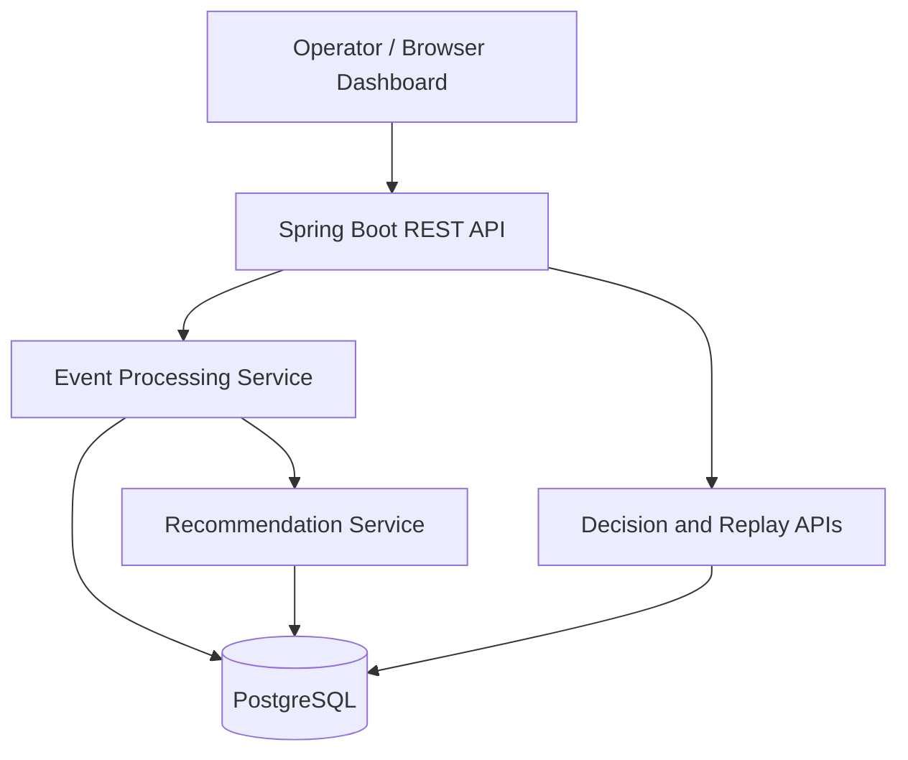

# RentalOps — Event-Driven Rental Operations Decision Support

A deployed Spring Boot application that turns short-term rental maintenance events into actionable recommendations, lets operators record decisions, and preserves a reviewable decision history.

> **Status:** V1 MVP deployed on Render. The public dashboard has been tested for recommendation generation, decision acceptance, and history retrieval. Replay is implemented but still needs public smoke-test confirmation.
> 

## Why RentalOps?

Rental operators need to respond to maintenance issues before they become guest complaints. RentalOps provides a structured workflow from event intake to an explainable recommendation and an operator decision.

## V1 capabilities

- Ingest and retrieve operational events using REST endpoints.
- Generate deterministic, rule-based maintenance recommendations with **CRITICAL**, **HIGH**, and **MEDIUM** priorities.
- Display recommended action and explanation in a browser-based decision workspace.
- Record operator decisions (**Accept**, **Modify**, **Reject**) and display decision history.
- Replay recommendation decisions for inspection.
- Handle repeated event submissions idempotently and reject conflicting duplicates.
- Protect concurrent duplicate submissions using PostgreSQL advisory locks.
- Persist event and generated recommendation atomically within a transaction.
- Package and deploy the application using Docker and Render with PostgreSQL.

## Architecture



For more details, see Architecture and engineering decisions.

## Tech stack

- **Backend:** Java 21, Spring Boot 4.1.1, Maven
- **Database:** PostgreSQL, Spring Data JPA
- **Frontend:** Static HTML / JavaScript served by Spring Boot
- **Infrastructure:** Docker, Render Web Service, Render PostgreSQL
- **Testing:** Maven test suite (14 tests passing locally at the latest recorded run)

## API overview

| Method | Endpoint | Purpose |
| --- | --- | --- |
| `POST` | `/events` | Ingest an operational event |
| `GET` | `/events` | List events |
| `GET` | `/events/{eventId}` | Retrieve a specific event |
| `GET` | `/events/{recommendationId}/decisions` | Retrieve operator decisions |
| `GET` | `/events/{recommendationId}/replay` | Inspect replay data |

**Event ingestion semantics:** new event → `201 Created`; identical retry → `200 OK`; conflicting duplicate → `409 Conflict`.

## Run locally

### Requirements

- Java 21
- Docker (for PostgreSQL)
- Git
1. Start a PostgreSQL instance and create a database and user for RentalOps.
2. Set environment variables for your local database connection:

```bash
export DB_URL='jdbc:postgresql://localhost:5432/rental'
export DB_USERNAME='rental_user'
export DB_PASSWORD='<your-local-password>'
```

1. Run tests and start the app:

```bash
./mvnw test
./mvnw spring-boot:run
```

1. Open `http://localhost:8080`.

The application reads `DB_URL`, `DB_USERNAME`, `DB_PASSWORD`, `DDL_AUTO`, `SHOW_SQL`, and `PORT` from the environment. Do not commit credentials.

## Cloud deployment

The V1 demo uses a Render Docker Web Service and a PostgreSQL database in the same region. Configure the database hostname with a **JDBC** URL:

```
DB_URL=jdbc:postgresql://<internal-host>:5432/<database>
DB_USERNAME=<database-user>
DB_PASSWORD=<secret>
DDL_AUTO=update
SHOW_SQL=false
```

**Live demo:** *Add the verified Render web service URL here.*

## Demo walkthrough

1. Open the dashboard and submit a **fictional** maintenance issue (e.g., “Bathroom light not working”).
2. Review the generated priority, action, and explanation.
3. Accept, modify, or reject the recommendation.
4. Refresh decision history and inspect the recorded action.
5. Open **View Replay** to inspect the recommendation flow (verify on the public deployment before claiming it in demos).

### Screenshots

*Add sanitized screenshots of the dashboard, generated recommendation, and decision history under `docs/images/`.*

## Engineering decisions

- **Idempotency:** identical retries do not create duplicate event records; conflicting submissions are rejected.
- **Concurrency:** PostgreSQL advisory locks coordinate duplicate event submissions.
- **Atomicity:** event ingestion and recommendation persistence are committed together or rolled back together.
- **Explainability:** the recommendation contains a priority, action, and explanation.
- **Human-in-the-loop:** operators can accept, modify, or reject recommendations, preserving feedback for future evaluation.

## Limitations and next steps

- **Demo-only security:** no authentication or authorization yet. Use synthetic data only; do not submit sensitive guest or property details.
- **Rules, not ML:** V1 uses deterministic keyword rules, not a trained ranking model.
- **Schema changes:** `DDL_AUTO=update` is used for MVP bootstrapping; adopt Flyway or another migration strategy for production.
- **Infrastructure:** Render’s free PostgreSQL database has an expiration date and is not durable long-term hosting.
- **V2 candidate scope:** asynchronous Kafka processing, idempotent consumers, retry / dead-letter handling, and observability.
- **V3 candidate scope:** candidate generation, ranking, and feedback-driven evaluation.

## License

*No license has been specified yet.*
