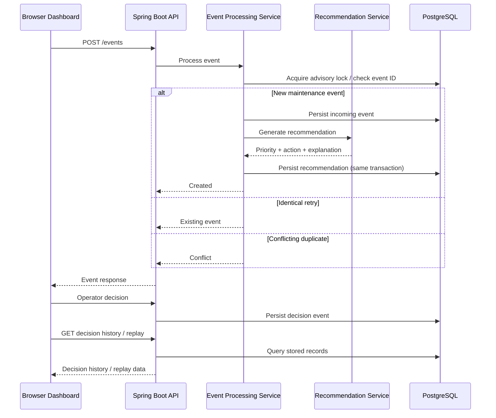
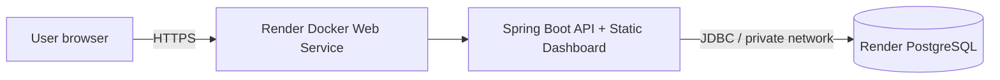

# RentalOps V1 — Architecture and Engineering Decisions

## System overview

RentalOps V1 is a synchronous, database-backed decision-support MVP. A browser dashboard communicates with a Spring Boot API, which persists incoming operational events, generates rule-based recommendations for maintenance issues, and records operator decisions in PostgreSQL.

## Recommendation rules

For `MaintenanceIssueDetected`, the current implementation uses keyword-based classification:

| Priority | Example signals                                                              | Recommended action                         |
| -------- | ---------------------------------------------------------------------------- | ------------------------------------------ |
| CRITICAL | Water leak, flood, gas leak, fire, smoke, sparking, electrical hazard        | Contact emergency maintenance immediately  |
| HIGH     | Heating failure, no hot water, AC failure, nonfunctional toilet, broken lock | Arrange urgent repair before guest arrival |
| MEDIUM   | Other maintenance issues                                                     | Schedule maintenance before next check-in  |

A recommendation ID is derived deterministically from its triggering event ID (`rec_` + event ID). Each recommendation stores its triggering event, priority, recommended action, and explanation.

## Reliability properties

### Idempotency

Repeated submissions with the same event ID and equivalent contents are treated as retries. A duplicate ID with different contents is rejected with HTTP `409`. This reduces accidental duplication when callers retry requests.

### Concurrency control

A PostgreSQL advisory lock is used to coordinate concurrent requests for the same event, avoiding races in duplicate-event handling. This is database-specific and would need reconsideration if the persistence layer changed.

### Transaction boundaries

Incoming event persistence and recommendation creation occur within a transaction. If recommendation creation fails, the event write is rolled back rather than leaving a partially processed maintenance issue.

### Human-in-the-loop decisions

The operator can accept, modify, or reject a generated action. The dashboard retrieves persisted decision history, supporting an auditable workflow and potential future ranking evaluation.

## Deployment topology

The Docker image uses a multi-stage build (Java 21 JDK build stage, Java 21 JRE runtime stage). Runtime connection settings come from environment variables rather than source-controlled secrets.

## Test and verification status

- Latest recorded local Maven test run: **14 tests passed**.
- Render deployment status: **Live** on October 11, 2026.
- Public dashboard screenshot verifies a generated MEDIUM recommendation, accepted decision, and history entry.
- Public replay flow: **not yet verified** in the provided evidence.

## Current limitations

- No authentication or authorization; public use should be restricted to synthetic demo data.
- Rule-based logic is not a learned recommendation model.
- No Kafka broker, asynchronous consumer, Redis cache, or ML ranking in V1.
- Schema management currently uses Hibernate update mode; production should use explicit migrations.
- Render free PostgreSQL instance shown in the dashboard is scheduled to expire November 10, 2026 unless upgraded or migrated.

## Next engineering iterations

**V2 — asynchronous reliability:** event producer, Kafka consumer, idempotent processing, bounded retries, dead-letter topic, and basic operational metrics. Design the transaction-to-publish boundary carefully (e.g., outbox pattern) to avoid losing events.

**V3 — decision quality:** candidate generation, scoring/ranking, explicit feedback signals, offline evaluation, and gradual experiments. Keep ranking deterministic and testable before introducing ML models.
